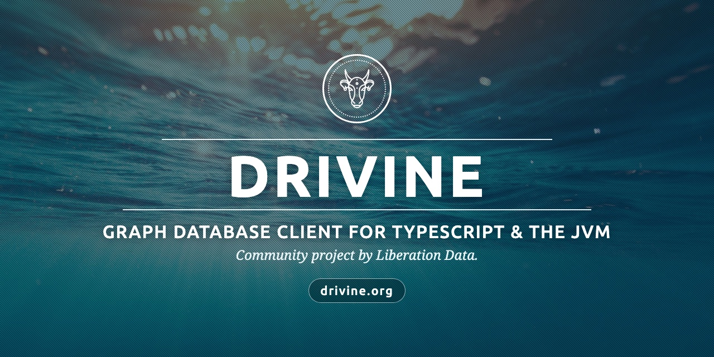
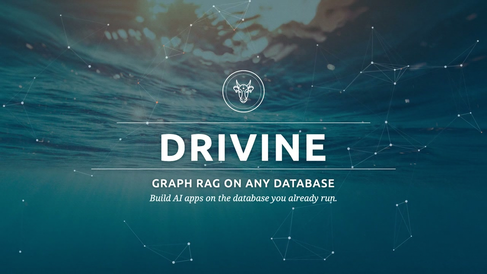

<a href="https://drivine.org/"></a>
# <a href="https://drivine.org/">drivine</a>

**Docs: [drivine.org](https://drivine.org/ts/)**, for TypeScript, Python, and Kotlin & Java.

<p align="center">
  <a href="https://www.youtube.com/watch?v=uETP0EN_04E" target="_blank">
    
  </a>
  <br>
  <a href="https://www.youtube.com/watch?v=uETP0EN_04E" target="_blank">▶ Watch Drivine in four and a half minutes: graph RAG on any database</a> (4:26, with captions)
</p>

Drivine is a graph database client for Node.js and TypeScript, with a [NestJS](https://nestjs.com/) module, and no need
for one. It supports **Neo4j**, **Memgraph**, **FalkorDB**, **Oracle** (SQL/PGQ), **Postgres** and **SQLite** as graph stores, plus
Amazon Neptune through the low-level API. It gives you two ways to work with a graph:

1. **PersistenceManager**: a low-level API where you write the queries yourself. This is the classic Drivine approach.
2. **Object manager** (`StatelessGraphObjectManager`): a high-level API that maps decorated classes, with a typed
   query DSL whose references come from the classes themselves.

A Cypher statement runs on every store: on Postgres, Oracle and SQLite, Drivine compiles it to SQL.

**SQLite** keeps a graph in one file, through Node's own `node:sqlite` (Node 22.13 or later), in the tables drivine4j and
drivine-python read. A transaction there gives one writer at a time: it takes the file's write lock as it begins, so even
one that only reads waits for the lock, up to the busy timeout. Reads outside a transaction don't wait for a writer; saves
and deletes outside one are retried when contended; each statement Drivine writes applies whole or not at all; and a
connection you open on the file yourself has none of this. From 5.0, compiled Cypher needs SQLite 3.53.2 or later,
which Node 22.23.4, 24.19.0 and 26.4.0 and later bundle; it is refused on an older SQLite, which writes a computed
float to 15 digits and refuses `last()` or a CALL that groups. Plain SQL runs on SQLite 3.45 or later. Use a Node whose
SQLite writes a computed float to 17 significant digits, as Node 22.23.4, 24.22.2 and 26.13 were measured to, for
example: a build of 3.53.2 or later may still write 15, which rounds a float it computes in compiled Cypher. Drivine
detects it at run time and warns once, as a process warning that `node --disable-warning=DRIVINE_SQLITE_ROUNDED_FLOATS`
silences. See [SQLite](docs/07-supported-engines.md#sqlite).

> **On Python or the JVM?** [drivine-python](https://github.com/liberation-data/drivine-python) (`pip install drivine`)
> is Drivine's Python twin, and [drivine4j](https://github.com/liberation-data/drivine4j) (`org.drivine:drivine4j`) its
> Java and Kotlin twin. The three share a storage format.

## Installation

```bash
npm install @liberation-data/drivine
```

Drivine needs `reflect-metadata` and `neo4j-driver` as peer dependencies, and NestJS (6 to 11) only for its module.
Enable `experimentalDecorators` and `emitDecoratorMetadata` in `tsconfig.json`.

## Quick Start

Connections come from the environment, or a `.env` file that Drivine loads:

```bash
DATABASE_TYPE=NEO4J          # NEO4J, MEMGRAPH, FALKORDB, ORACLE, NEPTUNE or POSTGRES
DATABASE_HOST=localhost
DATABASE_PORT=7687
DATABASE_USER=neo4j
DATABASE_PASSWORD=password
```

Then, without Nest, make the factories once and hand the managers to your classes:

```typescript
import {
    DatabaseRegistry,
    GraphObjectManagerFactory,
    PersistenceManagerFactory,
    StatelessGraphObjectManager,
    Transactional
} from '@liberation-data/drivine';

DatabaseRegistry.buildOrResolveFromEnv();
const persistenceManagers = new PersistenceManagerFactory();
const graphObjectManagers = new GraphObjectManagerFactory(persistenceManagers);

export class PersonService {
    constructor(readonly gom: StatelessGraphObjectManager = graphObjectManagers.get()) {}

    async leads(): Promise<PersonCareer[]> {
        return this.gom.loadAll(PersonCareer, (q) => ({ where: q.person.bio.containsIgnoreCase('lead') }));
    }

    @Transactional()
    async hire(person: Person): Promise<void> {
        await this.gom.save(person);
    }
}
```

With Nest, register `DrivineModule.withOptions(…)` from `@liberation-data/drivine/nest` and inject the managers. The
guide covers both, and the decorators behind `Person` and `PersonCareer`.

## Documentation

- The guide on [drivine.org](https://drivine.org/ts/), a page per section, beside drivine-python's and drivine4j's.
- The same guide on GitHub, in [docs/](https://github.com/liberation-data/drivine/tree/master/docs).
- [RELEASING.md](https://github.com/liberation-data/drivine/blob/master/RELEASING.md): how a release is made.

## Contributing

Questions go to [StackOverflow](https://stackoverflow.com/questions/tagged/drivine?sort=newest&pageSize=15), with the
Drivine tag, and bugs and feature requests to [GitHub issues](https://github.com/liberation-data/drivine/issues). To
build and test from source, see
[Building from Source](https://github.com/liberation-data/drivine/blob/master/docs/18-building-from-source.md). Please
follow the [code of conduct](https://github.com/liberation-data/drivine/blob/master/CODE_OF_CONDUCT.md).

## License

Copyright (c) 2022 Jasper Blues. Drivine is free software, under the Apache License, Version 2.0. See
[LICENSE](https://github.com/liberation-data/drivine/blob/master/LICENSE) and
[the licence section](https://github.com/liberation-data/drivine/blob/master/docs/19-license.md).
